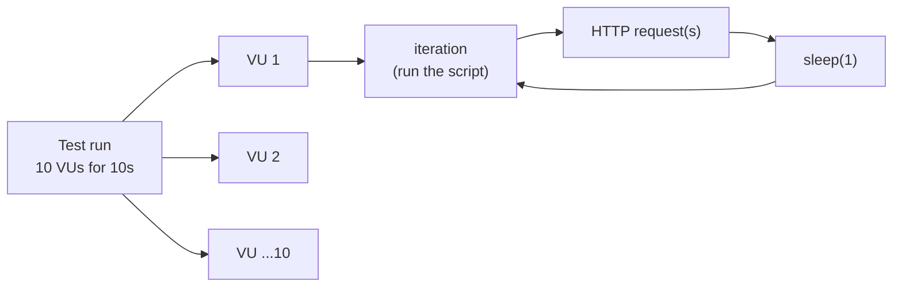
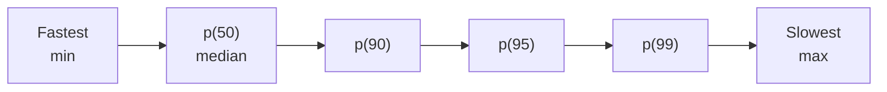
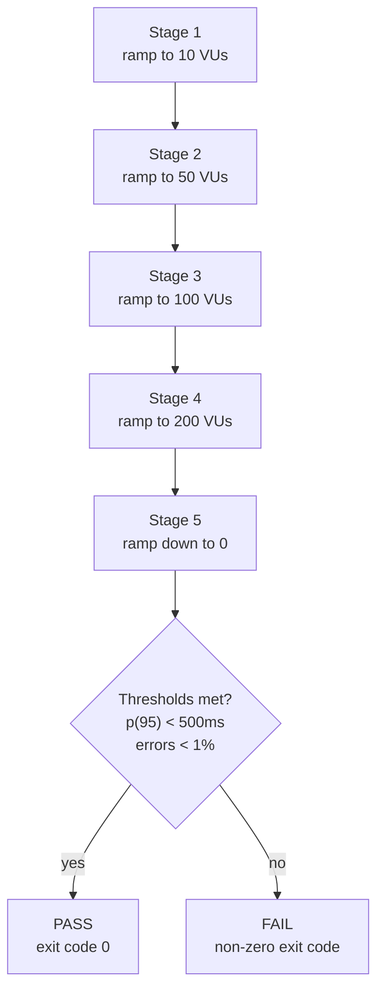

# Knowledge: reading k6 results

Reference for interpreting the output of a k6 load test. The [examples](EXAMPLES.md) link here for the metric details.

k6 is a load-testing tool that measures the performance of applications and APIs. After a run it prints a summary grouped into HTTP, EXECUTION, and NETWORK metrics.

## Test configuration

```
scenarios: 1 scenario, 10 max VUs
default: 10 looping VUs for 10s
```

| Parameter | Meaning |
|---|---|
| `10 VUs` | 10 concurrent virtual users |
| `10s` | Duration of the load |
| `30s gracefulStop` | Extra time allowed for in-flight iterations to finish |
| `iterations` | Number of complete script executions |
| `http_reqs` | Number of HTTP requests executed |

**Important:** `10 VUs` does not mean 10 simultaneous requests at all times. Each virtual user runs the script and starts over when its iteration finishes.

The execution model — each VU loops through iterations, and each iteration runs your script (which may send several HTTP requests):



Every VU repeats `iteration → request(s) → sleep → iteration` until the duration ends. Totals like `iterations` and `http_reqs` are the sum across all VUs.

## HTTP response times

The `http_req_duration` line reports the distribution of response times:

```
http_req_duration: avg=86.27ms min=11.9ms med=88.21ms max=163.37ms p(90)=159.21ms p(95)=160.48ms
```

- **avg** — average (mean) response time across all requests.
- **min** — the single fastest request.
- **med** — median: half of the requests responded in this time or less.
- **p(90)** — 90th percentile (see below).
- **p(95)** — 95th percentile.
- **max** — the single slowest request.

### What a percentile is

A percentile is a value below which a given share of your measurements fall, once they are sorted from fastest to slowest.

**`p(95) = 160.48 ms` means: 95% of requests completed in 160.48 ms or less, and the slowest 5% took longer than that.**

How it's computed, conceptually:

1. Take every request's duration and sort them from smallest to largest.
2. To find `p(95)`, walk 95% of the way through that sorted list.
3. The value at that position is the 95th percentile.

So the percentile is a *position in the sorted data*, not an average. The median is simply `p(50)` — the halfway point.

Visually, with requests sorted fastest to slowest, each percentile is a cut point along that line:



Everything to the left of `p(95)` is the 95% of requests that were that fast or faster; the small slice to its right is the slowest 5%.

### What it measures (and why it matters)

A percentile measures the **experience of the slowest requests**, which is exactly what users notice. It answers "how bad does it get for most of my traffic?" without being dragged around by a single outlier.

Common percentiles and what they tell you:

| Percentile | Reading | Typical use |
|---|---|---|
| `p(50)` / median | Half of requests are faster than this | The "typical" request |
| `p(90)` | 9 out of 10 requests are this fast or faster | Catches the slower tail |
| `p(95)` | 19 out of 20 requests are this fast or faster | Common SLA/SLO target |
| `p(99)` | 99 out of 100 requests are this fast or faster | Worst-case for almost everyone |

### Why not just use the average?

The average hides problems. If 95 requests take 50 ms and 5 take 3000 ms, the average still looks acceptable, but 1 in 20 users had a terrible experience. A percentile exposes that tail:

- **avg** is skewed by outliers — a few very slow (or very fast) requests move it.
- **p(95)/p(99)** stay representative because they describe a fixed position in the distribution.
- **max** is a single request and can be pure noise (one GC pause, one network blip).

That's why SLAs and SLOs are usually written against `p(95)` or `p(99)`, not the average. In the example above, `avg=86.27 ms` but `p(95)=160.48 ms` — the typical request is fast, yet the slower slice is almost twice as slow, and that slice is what you design capacity and thresholds around.

`http_req_failed` is the share of failed requests. `0.00%` means every request met k6's expected-response criteria — but that alone does not guarantee the response *data* was correct, nor that the app tolerates higher load. Use `check()` assertions and larger tests to confirm.

## Requests and throughput

```
http_reqs........: 180    16.14/s
iterations.......: 90      8.07/s
```

- The app served roughly **16.14 requests per second (RPS)** over the measured window.
- About **8.07 iterations per second** completed.
- Each iteration made ~2 HTTP requests on average (`http_reqs / iterations`).

Note the gap between iteration and request duration:

```
iteration_duration: avg=1.23s
http_req_duration:  avg=86.27ms
```

An iteration takes ~1.23s even though a single HTTP request takes ~86ms. This is usually because the script calls `sleep(1)`, makes several requests, or does extra work — it does **not** mean the API itself took 1.23s to respond.

## Did the application pass?

```
http_req_failed: 0.00%  0 out of 180
```

All requests were considered successful by k6. However, a 0% error rate does not prove the app scales further or returns correct data. To verify that, add validations and test with more users.

## Testing scalability

Use a staged (ramping) profile to see how the app behaves as concurrency grows, and define `thresholds` as pass/fail objectives:

```javascript
import http from 'k6/http';
import { check, sleep } from 'k6';

export const options = {
  stages: [
    { duration: '30s', target: 10 },
    { duration: '30s', target: 50 },
    { duration: '30s', target: 100 },
    { duration: '30s', target: 200 },
    { duration: '30s', target: 0 },
  ],
  thresholds: {
    http_req_duration: ['p(95)<500'],
    http_req_failed: ['rate<0.01'],
  },
};

export default function () {
  const res = http.get('https://your-api.com/health');

  check(res, {
    'status 200': (r) => r.status === 200,
  });

  sleep(1);
}
```

This ramps virtual users progressively, then checks the results against the thresholds to decide pass or fail:



It evaluates two objectives:

- **p95** stays below 500 ms.
- HTTP error rate stays below 1%.

If any threshold is breached, k6 exits with a non-zero code — useful for failing a CI pipeline automatically.

Run scalability tests only in an authorized environment with enough capacity — especially against production.

## Going further

Beyond raw numbers, a load test can answer:

- How many RPS the application actually sustains.
- When latency starts to degrade.
- How autoscaling (HPA, KEDA, Karpenter) reacts under the load, for services running in Kubernetes.

The right next step depends on the stack under test (Go, Python, Node.js, or a Kubernetes-hosted service).
